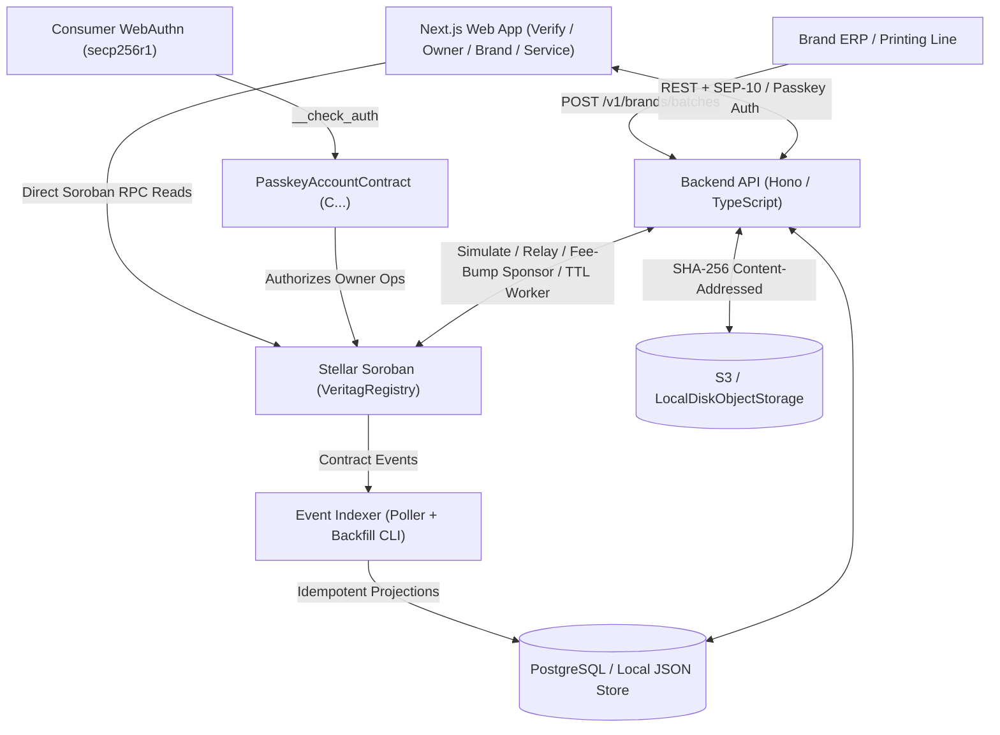

# Veritag Architecture

Veritag separates immutable cryptographic truth on **Stellar Soroban** from high-throughput indexing, print-line secret provisioning, and encrypted document storage off-chain.

## Component Topology

## On-Chain Smart Contracts (`contracts/`)

1. **`contracts/registry` (`VeritagRegistry`):**
   - Single multi-tenant authenticity and warranty registry serving all verified brands.
   - Uses **Instance** storage for `Config`, **Persistent** storage for `Brand`, `ServiceCenter`, `Batch`, `Unit`, and `Claim` (with TTLs automatically extended to cover the remaining warranty + 90-day buffer), and **Temporary** storage for expiring `TransferOffer` codes.
2. **`contracts/passkey-account` (`PasskeyAccountContract`):**
   - Implements Soroban `CustomAccountInterface` (`__check_auth`) verifying WebAuthn `authenticatorData` (User Present bit), base64url challenge binding in `clientDataJSON`, and `secp256r1_verify` (P-256) hardware signatures, plus optional `Recovery` signer fallback and passkey rotation (`add_passkey`, `remove_passkey`).
3. **`contracts/account-factory` (`AccountFactoryContract`):**
   - Deterministically deploys `PasskeyAccountContract` instances via `env.deployer().with_current_contract(salt).deploy_v2(...)` so consumers get a predictable `C...` Soroban smart wallet address from their WebAuthn credential ID before or during first product activation.

## Identifier & Merkle Construction

All sensitive serials and secrets are hashed before touching the chain:

1. `serial_hash = sha256(serial_utf8_bytes)`
2. `secret_hash = sha256(secret_utf8_bytes)`
3. `leaf = sha256(serial_hash || secret_hash)`
4. `parent = sha256(min(left, right) || max(left, right))` (lexicographically sorted sibling pairs)
5. `unit_id = sha256(brand_address_xdr || batch_id || serial_hash)`

Sorted-pair internal hashing allows compact `Vec<BytesN<32>>` proofs without auxiliary left/right bitvectors and guarantees deterministic parity between Rust (`contracts/registry/src/merkle.rs`) and TypeScript (`packages/sdk/src/merkle.ts`).

## Event-Sourced Indexer & Backfill (`indexer/`)

Soroban RPC nodes retain historical events for a bounded retention window. The Veritag indexer:

1. Polls `getEvents` filtered by `REGISTRY_CONTRACT_ID` using persisted cursors in `indexer_state`.
2. Supports ledger-range backfill via `veritag-indexer --backfill --from <startLedger> --to <endLedger>`.
3. Decodes XDR `ScVal` topics and map payloads produced by `#[contractevent]` into typed TypeScript events.
4. Applies projections idempotently inside PostgreSQL transactions keyed by event ID (`ON CONFLICT (id) DO NOTHING`).
5. Tracks confirmation depth (`INDEXER_CONFIRMATION_LEDGERS`) before marking events `finalized = true`.
