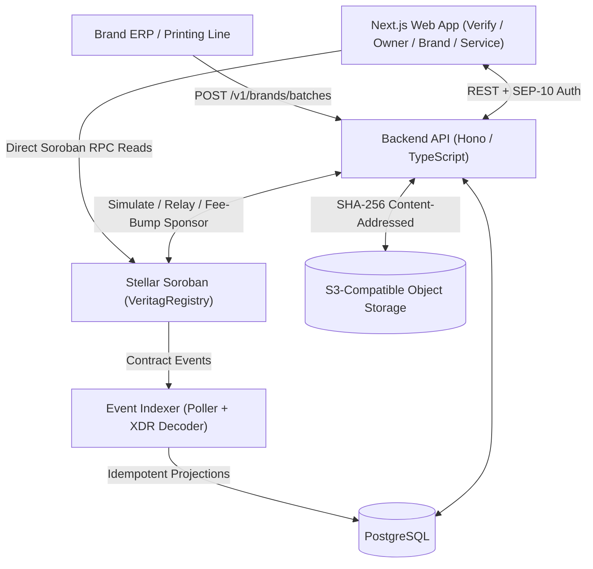

# Veritag Architecture

Veritag separates immutable cryptographic truth on **Stellar Soroban** from high-throughput indexing, print-line secret provisioning, and encrypted document storage off-chain.

## Component Topology

## On-Chain Data Model (`contracts/registry`)

A single `VeritagRegistry` contract serves all verified manufacturers:

| Storage Tier | Key | Lifecycle & TTL |
|---|---|---|
| **Instance** | `DataKey::Config` | Extended on administrative & lifecycle writes (`admin`, `max_claims_per_unit`). |
| **Persistent** | `DataKey::Brand(Address)` | Brand domain (`stellar.toml`), verification flag, and rotatable signing `admin`. |
| **Persistent** | `DataKey::ServiceCenter(Address, Address)` | Per-brand authorized service center allowlist. |
| **Persistent** | `DataKey::Batch(Address, BytesN<32>)` | Single 32-byte Merkle root, warranty duration, metadata hash, unit count, recall flag. |
| **Persistent** | `DataKey::Unit(BytesN<32>)` | Created **lazily** on `activate`; TTL extended to cover remaining warranty + 90-day buffer (clamped to network `max_ttl`). |
| **Temporary** | `DataKey::Offer(BytesN<32>)` | One-time resale transfer code hash; automatically expires and prunes from ledger state. |
| **Persistent** | `DataKey::Claim(BytesN<32>, u32)` | Service claim history with outcome and off-chain diagnostic report SHA-256 hash. |

## Identifier & Merkle Construction

All sensitive serials and secrets are hashed before touching the chain:

1. `serial_hash = sha256(serial_utf8_bytes)`
2. `secret_hash = sha256(secret_utf8_bytes)`
3. `leaf = sha256(serial_hash || secret_hash)`
4. `parent = sha256(min(left, right) || max(left, right))` (lexicographically sorted sibling pairs)
5. `unit_id = sha256(brand_address_xdr || batch_id || serial_hash)`

Sorted-pair internal hashing allows compact `Vec<BytesN<32>>` proofs without auxiliary left/right bitvectors and guarantees deterministic parity between Rust (`contracts/registry/src/merkle.rs`) and TypeScript (`packages/sdk/src/merkle.ts`).

## Event-Sourced Indexer (`indexer/`)

Soroban RPC nodes retain historical events for a bounded retention window. The Veritag indexer:

1. Polls `getEvents` filtered by `REGISTRY_CONTRACT_ID` using persisted cursors in `indexer_state`.
2. Falls back cleanly to `startLedger` if a cursor ages out of RPC retention.
3. Decodes XDR `ScVal` topics and map payloads produced by `#[contractevent]` into typed TypeScript events.
4. Applies projections idempotently inside PostgreSQL transactions keyed by event ID (`ON CONFLICT (id) DO NOTHING`), preventing double-counting on restarts or backfills.
5. Tracks confirmation depth (`INDEXER_CONFIRMATION_LEDGERS`) before marking events `finalized = true`.
