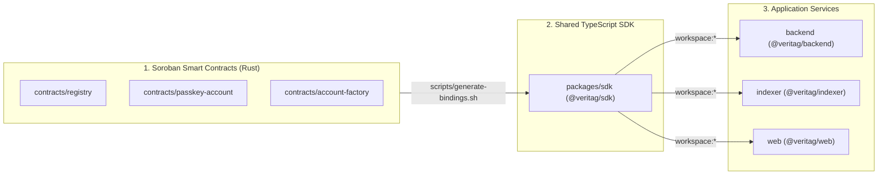

# Veritag Contributor Onboarding & Troubleshooting Guide

Welcome to the **Veritag** contributor community! This guide provides OS-specific environment setup instructions (macOS, Ubuntu/Debian Linux, and Windows WSL2), workspace build order diagrams, and a 10-point troubleshooting runbook for contributors in the **Drips Stellar Wave Program**.

---

## 1. System Architecture & Monorepo Build Order

Veritag is a hybrid **Rust (Soroban WASM)** + **TypeScript (`pnpm` workspaces)** monorepo. Because `backend`, `indexer`, and `web` depend on `@veritag/sdk`, `@veritag/sdk` must be built first.



---

## 2. Operating System Setup Instructions

### 2.1 macOS (Homebrew)

```bash
# 1. Install system dependencies, Node.js 22, and Docker/OrbStack
brew install git curl jq node@22 rustup-init

# 2. Initialize Rust stable toolchain & Soroban WASM target
rustup-init -y
source "$HOME/.cargo/env"
rustup toolchain install stable
rustup target add wasm32v1-none
rustup component add clippy rustfmt

# 3. Enable pnpm via Corepack
corepack enable
corepack prepare pnpm@latest --activate

# 4. Install Stellar CLI
brew install stellar-cli
# Or via Cargo: cargo install --locked stellar-cli --features opt
```

### 2.2 Ubuntu / Debian Linux

```bash
# 1. Install build essentials, pkg-config, and OpenSSL headers
sudo apt-get update
sudo apt-get install -y build-essential pkg-config libssl-dev git curl jq ca-certificates

# 2. Install Rust & wasm32v1-none target
curl --proto '=https' --tlsv1.2 -sSf https://sh.rustup.rs | sh -s -- -y
source "$HOME/.cargo/env"
rustup target add wasm32v1-none
rustup component add clippy rustfmt

# 3. Install Node.js 22 & pnpm
curl -fsSL https://deb.nodesource.com/setup_22.x | sudo -E bash -
sudo apt-get install -y nodejs
sudo corepack enable

# 4. Install Stellar CLI
cargo install --locked stellar-cli --features opt
```

### 2.3 Windows (WSL2 Ubuntu 22.04 / 24.04 Recommended)

1. Open PowerShell as Administrator and enable WSL2:
   ```powershell
   wsl --install -d Ubuntu-24.04
   ```
2. Install **Docker Desktop for Windows** and enable **Use the WSL 2 based engine** + integration with your `Ubuntu-24.04` distro under *Settings -> Resources -> WSL Integration*.
3. Clone the repository inside your Linux filesystem (`~/Veritag`), **not** under `/mnt/c/...`, to avoid slow cross-OS file I/O and CRLF line-ending issues:
   ```bash
   git config --global core.autocrlf input
   git clone https://github.com/pendulum-max/Veritag.git ~/Veritag
   cd ~/Veritag
   ```
4. Follow the **Ubuntu / Debian Linux** commands in Section 2.2 above.

---

## 3. Step-by-Step Verification Workflow

Run these commands from the repository root to verify your local setup:

```bash
# 1. Install TypeScript dependencies with frozen lockfile
pnpm install --frozen-lockfile

# 2. Build WASM release artifacts (required by account-factory tests)
cargo build --workspace --target wasm32v1-none --release

# 3. Run Rust Clippy & unit tests
cargo clippy --workspace --all-targets -- -D warnings
cargo test --workspace

# 4. Build TypeScript packages, typecheck, and run Vitest suites
pnpm build
pnpm lint
pnpm test
```

---

## 4. Top 10 Troubleshooting Runbook

### Problem 1: `include_bytes!("../../../target/wasm32v1-none/release/passkey_account.wasm"): No such file or directory`
- **Cause:** `contracts/account-factory/src/test.rs` embeds the compiled `passkey_account.wasm` binary to test deterministic `deploy_v2` contract deployment.
- **Fix:** Compile the workspace for the `wasm32v1-none` release target before running `cargo test --workspace`:
  ```bash
  rustup target add wasm32v1-none
  cargo build --workspace --target wasm32v1-none --release
  cargo test --workspace
  ```

### Problem 2: `error[E0463]: can't find crate for core` when building for `wasm32v1-none`
- **Cause:** Your active Rust toolchain is older than Rust `1.84` or missing the `wasm32v1-none` standard library target.
- **Fix:** Update Rust stable and add the target:
  ```bash
  rustup update stable
  rustup target add wasm32v1-none
  ```

### Problem 3: `Cannot find module '@veritag/sdk' or its corresponding type declarations`
- **Cause:** `backend`, `indexer`, and `web` import compiled declarations from `packages/sdk/dist`. If `@veritag/sdk` has not been built yet, TypeScript cannot resolve `@veritag/sdk`.
- **Fix:** Build `@veritag/sdk` first (or run `pnpm build` from root):
  ```bash
  pnpm --filter @veritag/sdk build
  ```

### Problem 4: `ERR_PNPM_OUTDATED_LOCKFILE` or `pnpm install --frozen-lockfile` fails in CI
- **Cause:** Modifying `package.json` without updating `pnpm-lock.yaml`, or using a different major `pnpm` version.
- **Fix:** Ensure Corepack uses the repository's configured `pnpm` version and avoid unnecessary dependency changes unless required by the issue.

### Problem 5: Docker permission denied (`permission denied while trying to connect to the Docker daemon socket`)
- **Cause:** Your Linux user is not in the `docker` group.
- **Fix:**
  ```bash
  sudo usermod -aG docker "$USER"
  newgrp docker
  ```

### Problem 6: PostgreSQL connection refused (`ECONNREFUSED 127.0.0.1:5432`) during `pnpm db:migrate`
- **Cause:** Either the `veritag-postgres` container is not running, or another local Postgres service is occupying port `5432`.
- **Fix:** Check `docker compose ps` and wait for `veritag-postgres` to report `(healthy)`:
  ```bash
  docker compose up -d postgres
  docker compose ps
  pnpm db:migrate
  ```

### Problem 7: MinIO S3 upload fails with `NoSuchBucket: The specified bucket does not exist` or CORS error
- **Cause:** The `veritag-files` bucket was not initialized in MinIO.
- **Fix:** Run the `minio-init` service from `docker-compose.yml`:
  ```bash
  docker compose up -d minio minio-init
  ```

### Problem 8: `cargo clippy --workspace --all-targets -- -D warnings` fails on `env.events().publish(...)`
- **Cause:** `soroban-sdk = "27"` deprecates raw `env.events().publish(...)` in favor of typed `#[contractevent]` structs.
- **Fix:** Define an event struct with `#[contractevent]` and call `MyEvent { ... }.publish(&env);` (see `contracts/registry/src/events.rs` for examples).

### Problem 9: WebAuthn `navigator.credentials.create` fails in local browser testing
- **Cause:** WebAuthn requires a secure context (`https://` or `http://localhost`). Accessing the Next.js dev server via a LAN IP (`http://192.168.x.x:3000`) disables `navigator.credentials`.
- **Fix:** Access the web app via `http://localhost:3000` or use an HTTPS tunnel (`ngrok` / `cloudflared`) when testing on mobile devices.

### Problem 10: Windows CRLF line endings break shell scripts (`scripts/*.sh: /bin/sh^M: bad interpreter`)
- **Cause:** Git on Windows converted LF line endings to CRLF on checkout.
- **Fix:** Configure Git to preserve LF endings on `.sh` files:
  ```bash
  git config core.autocrlf input
  dos2unix scripts/*.sh
  ```
