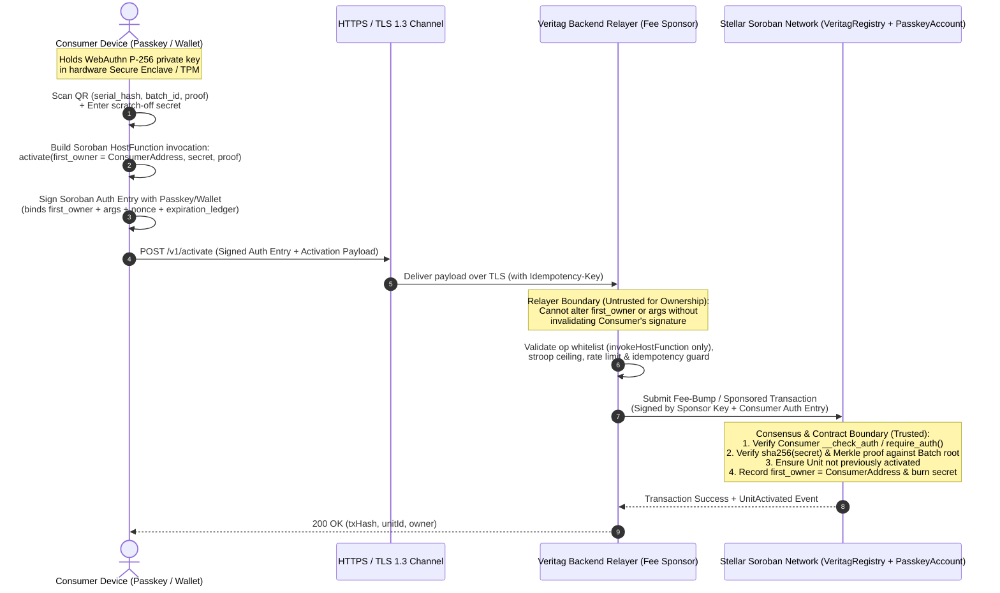

# Veritag Threat Model

This document expands on the security properties, trust boundaries, and mitigations implemented across the Veritag contract, backend relayer, indexer, and client applications.

## Trust Assumptions

1. **Stellar Soroban Consensus:** Assumed honest-majority and Byzantine-fault-tolerant for transaction finality, `require_auth` signature verification, and ledger timestamps.
2. **Backend & Database:** Treated as **untrusted for authenticity and ownership**. Even if PostgreSQL or the REST backend is compromised or offline, it cannot forge a Merkle batch commitment, transfer an owned unit without the owner's signature, or erase past on-chain events.
3. **Registry Admin:** Trusted only to verify that a registering brand controls its claimed DNS domain via `https://<domain>/.well-known/stellar.toml`. Recommended to be a Stellar multisig account in production.
4. **Fee-Sponsoring Relayer:** Trusted only for **liveness and XLM fee sponsorship**. The relayer is explicitly **untrusted** for unit ownership assignment, passkey custody, warranty claim authorization, and resale transfers.

---

## Architectural Trust Boundaries & Activation Sequence

The following sequence diagram illustrates the cryptographic trust boundaries between the untrusted client network, the semi-trusted fee-sponsoring relayer, and the authoritative Soroban smart contracts (`VeritagRegistry`, `PasskeyAccountContract`, and `AccountFactoryContract`).

---

## Attack Surfaces & Mitigations

### 1. QR Label Cloning & Mass Counterfeiting
- **Attack:** A counterfeiter photographs a genuine product's outer QR code in a retail store and prints 10,000 copies onto fake boxes.
- **Mitigations:**
  - **Batch Membership:** Invented serials fail Merkle verification (`VerifyStatus::Unknown`).
  - **Hidden Scratch-Off Secret:** `activate` requires the raw `secret` printed inside sealed packaging or beneath a tamper-evident scratch layer. Outer QR links never contain the secret.
  - **Burn on First Claim:** Once activated, the `Unit` record exists permanently. Subsequent activation attempts fail with `UnitAlreadyActivated`, while `report_duplicate_attempt` increments `duplicate_attempts` on-chain and triggers a public warning banner.
  - **Scan Telemetry:** Every public scan increments `scan_count`. Abnormal scan counts (>50 scans on an unclaimed item) surface a high-visibility cloning alert.

### 2. Activation Front-Running
- **Attack:** An attacker observes a pending `activate` transaction in the mempool, extracts `(serial_hash, proof, secret)`, and submits a competing transaction setting `first_owner` to the attacker's address.
- **Mitigation:** `VeritagRegistry::activate` enforces `first_owner.require_auth()`. A transaction signed by Alice cannot be re-targeted to Bob, and user activation requests travel directly to the fee-sponsoring relayer over TLS rather than gossiping unsigned secrets.

### 3. Pre-Shipment Merkle Secret Leakage
- **Attack:** Database compromise at the brand middleware exposes raw scratch-off secrets prior to retail sale.
- **Mitigations:**
  - Secrets are encrypted at rest with AES-256-GCM (`backend/src/services/merkle.ts`) immediately upon generation.
  - Print-line export (`GET /v1/brands/batches/:id/export?purge=true`) wipes `encrypted_secret` columns immediately after factory export (`410 Gone` on any subsequent export attempt), leaving only public `serial_hash`, `secret_hash`, and Merkle `proof` hashes in storage.

### 4. Fee Sponsor Account Draining
- **Attack:** Bots spam `/v1/activate` or `/v1/sponsor` to exhaust the sponsor account's XLM balance, or wrap arbitrary XLM `payment` operations inside sponsored transactions.
- **Mitigations:**
  - `StellarFeeSponsorService` inspects the inner transaction XDR and rejects any transaction with `!= 1` operation or any operation other than `invokeHostFunction`, `restoreFootprint`, or `extendFootprintTtl`.
  - Enforces a hard per-transaction stroop ceiling, per-account rolling stroop budget, per-IP rolling stroop budget, and `SlidingWindowRateLimiter` on public and authenticated write routes.

### 5. Brand Key Compromise & Rogue Service Centers
- **Attack:** A brand signing key or a third-party repair shop key is compromised.
- **Mitigations:**
  - Brands can rotate their operational signing key via `rotate_brand_admin(brand, new_admin)` while preserving their canonical `brand` address across all historical batches and QR URLs.
  - Service centers are scoped per-brand (`DataKey::ServiceCenter(brand, sc)`) and can be revoked instantaneously via `revoke_service_center`, which immediately blocks `file_claim` and `resolve_claim`.

### 6. Soroban State Archival
- **Attack / Operational Risk:** Persistent unit or batch records expire after multi-year warranties, causing verification or resale transfers to fail.
- **Mitigations:**
  - `activate` and all lifecycle mutations extend unit and batch TTLs to cover the remaining warranty plus a 90-day buffer (safely clamped to `env.storage().max_ttl()`).
  - Permissionless `bump_unit_ttl` and `bump_batch_ttl` entrypoints allow scheduled maintenance jobs to refresh long-lived warranties before archival.

---

## Relayer Man-in-the-Middle (MitM) & Fee-Sponsorship Threat Analysis

Because consumer activations and passkey transactions traverse the backend fee-sponsoring relayer, the relayer sits on the network path between the consumer device and Stellar RPC validators. Below is a formal analysis of relayer-specific threat vectors and protocol mitigations.

### 7. Relayer Threat Vectors

#### 7.1 Relayer Key Compromise
- **Threat Description:** An adversary compromises the backend server environment and extracts `STELLAR_SPONSOR_SECRET` (the relayer's Ed25519 hot wallet secret key).
- **Attack Capabilities & Boundaries:**
  - The attacker can spend the XLM balance held in the dedicated fee-sponsor hot wallet.
  - The attacker **cannot** steal activated product units, initiate resale transfers (`offer_transfer` / `accept_transfer`), file fraudulent warranty claims (`file_claim`), or commit fake brand batches (`commit_batch`), because the relayer key holds zero administrative or ownership privileges in `VeritagRegistry` or `PasskeyAccountContract`.
- **Protocol Mitigations:**
  - **Least-Privilege Hot Wallet Isolation:** The sponsor account is strictly a gas-paying account with a capped XLM float replenished via automated treasury top-ups.
  - **On-Chain Authorization Separation:** `VeritagRegistry` verifies `first_owner.require_auth()`, `owner.require_auth()`, and `brand_admin.require_auth()` independently of the outer transaction fee source (`env.invoker()` is never trusted for ownership).

#### 7.2 Fee Siphoning & Unauthorized Sponsorship Abuse
- **Threat Description:** A malicious client crafts a Soroban transaction that invokes an unrelated expensive contract, embeds hidden XLM transfers, or inflates resource instructions to siphon XLM fees from the relayer via `/v1/sponsor`.
- **Protocol Mitigations:**
  - **Strict XDR Envelope Inspection:** `StellarFeeSponsorService` parses the raw transaction envelope before signing and enforces:
    1. Exactly one operation in the inner transaction (`operations.length === 1`).
    2. Operation type restricted to `invokeHostFunction`, `restoreFootprint`, or `extendFootprintTtl` targeting whitelisted Veritag contract IDs (`REGISTRY_CONTRACT_ID`, `ACCOUNT_FACTORY_CONTRACT_ID`, or deployed `PasskeyAccount` instances).
    3. Maximum per-transaction fee ceiling (`MAX_SPONSORED_FEE_STROOPS`) and per-IP / per-account sliding-window stroop budgets.

#### 7.3 Scratch-Secret Interception in HTTP Transit & Relayer Memory
- **Threat Description:** A network-level Man-in-the-Middle (MitM) or a compromised relayer node intercepts the raw `secret` during an activation request and attempts to substitute the attacker's Stellar address as `first_owner`.
- **Protocol Mitigations:**
  - **Client-Signed Soroban Authorization Entries:** When a consumer activates a unit using a Passkey smart account or Stellar wallet, the `SorobanAuthorizationEntry` is signed on the client device over the exact invocation tuple `(contract_id, "activate", [brand, batch_id, serial_hash, secret, proof, first_owner])` plus `nonce` and `signature_expiration_ledger`.
  - **Cryptographic Binding of `first_owner`:** In `PasskeyAccountContract::__check_auth`, the P-256 WebAuthn signature verifies `SHA-256(authenticator_data || SHA-256(client_data_json))` where `client_data_json.challenge` equals `base64url(signature_payload)`. If the relayer or a MitM modifies `first_owner` while reusing the consumer's auth entry, `signature_payload` changes and Soroban host verification aborts with `AccountError::ChallengeMismatch`.
  - **One-Time On-Chain Secret Commitment (`sha256(secret)`):** On-chain Merkle leaves commit to `SHA-256(serial_hash || SHA-256(secret))`. Once a valid transaction commits to the ledger, the unit state transitions atomically to `UnitStatus::Active` and permanently binds `first_owner`. Any replay of the intercepted `secret` in a subsequent ledger fails with `RegistryError::UnitAlreadyActivated`.

#### 7.4 Transaction Front-Running & Double-Spend Reordering
- **Threat Description:** A compromised relayer or malicious RPC gateway withholds a user's unsigned/unauthenticated activation request or reorders concurrent activation/transfer requests to win a race condition.
- **Protocol Mitigations:**
  - **End-to-End Signed Auth Payloads:** By requiring client-side signing of the Soroban authorization context prior to submission, the relayer cannot construct a valid competing signature for a Passkey-authenticated invocation.
  - **Idempotency Guarantees:** Mutation endpoints enforce deterministic request deduplication (`Idempotency-Key` / payload digest locking) so network retries or duplicate submissions return the original transaction receipt rather than submitting conflicting transactions.
  - **Sequential Nonce & Ledger Expiration Bounds:** Soroban authorization entries include short `signature_expiration_ledger` windows and per-credential/account nonces, preventing delayed replay of withheld transactions after state transitions.

#### 7.5 Relayer Denial-of-Service (Censorship / Liveness Failure)
- **Threat Description:** The backend relayer goes offline, drops requests selectively (censorship), or suffers DDoS exhaustion.
- **Protocol Mitigations:**
  - **Permissionless Direct RPC Submission Bypass:** `VeritagRegistry` and `PasskeyAccountContract` do not require transactions to originate from the Veritag relayer. Any consumer or brand can submit `activate`, `offer_transfer`, `accept_transfer`, or `file_claim` directly to any public Stellar Soroban RPC node by paying standard network fees (~100–10,000 stroops).

---

## Formal Threat Matrix

| ID | Threat Vector | Target Component | Likelihood | Impact | Primary Protocol Mitigation | Residual Risk |
| :--- | :--- | :--- | :---: | :---: | :--- | :---: |
| **TM-01** | Physical QR Label Cloning | Consumer Verification (`VeritagRegistry`) | High | High | Hidden inner scratch-off secret + Merkle leaf binding `SHA-256(serial_hash \|\| SHA-256(secret))` + single-use activation burn + scan count anomaly telemetry | **Low** |
| **TM-02** | Relayer Hot Wallet Key Compromise | Backend Relayer (`StellarFeeSponsorService`) | Low | Medium | Sponsor key holds zero contract privileges; capped hot-wallet XLM float; all contract mutations require independent user/brand `require_auth()` | **Low** |
| **TM-03** | Fee Siphoning via Malicious Sponsored XDR | Backend Relayer (`/v1/sponsor`) | Medium | Medium | Strict XDR operation whitelist (`invokeHostFunction` / TTL ops only), target contract ID allowlist, per-tx stroop ceiling, and sliding-window rate limits | **Low** |
| **TM-04** | MitM Scratch-Secret Interception & Owner Substitution | HTTP Transit / Relayer Node | Low | Critical | TLS 1.3 transport + client-signed `SorobanAuthorizationEntry` binding `first_owner` to P-256 WebAuthn / Ed25519 signature (`ChallengeMismatch` on tampering) | **Low** |
| **TM-05** | Relayer Front-Running & Request Reordering | Relayer / Stellar RPC Mempool | Low | High | Client-side auth entry signatures + short `signature_expiration_ledger` + atomic single-slot Soroban finality + request idempotency locking | **Low** |
| **TM-06** | Pre-Shipment Database Secret Theft | Backend PostgreSQL (`merkle.ts`) | Low | High | AES-256-GCM encryption at rest + mandatory one-time factory export purge (`?purge=true` -> `410 Gone`) before physical shipment | **Low** |
| **TM-07** | Brand Admin or Service Center Key Compromise | `VeritagRegistry` Governance | Low | High | On-chain `rotate_brand_admin` key rotation + instant per-brand `revoke_service_center` revocation + M-of-N multisig recommendation | **Low** |
| **TM-08** | Relayer Censorship or Liveness Outage | Backend API / Relayer | Medium | Medium | Permissionless contract entrypoints allow direct submission to any public Stellar Soroban RPC node without relayer involvement | **Low** |
| **TM-09** | Long-Term Warranty State Archival | Soroban Persistent Storage | Medium | Medium | Automatic TTL extension on `activate`/mutations (warranty + 90-day buffer) + permissionless `bump_unit_ttl` / `bump_batch_ttl` | **Low** |
